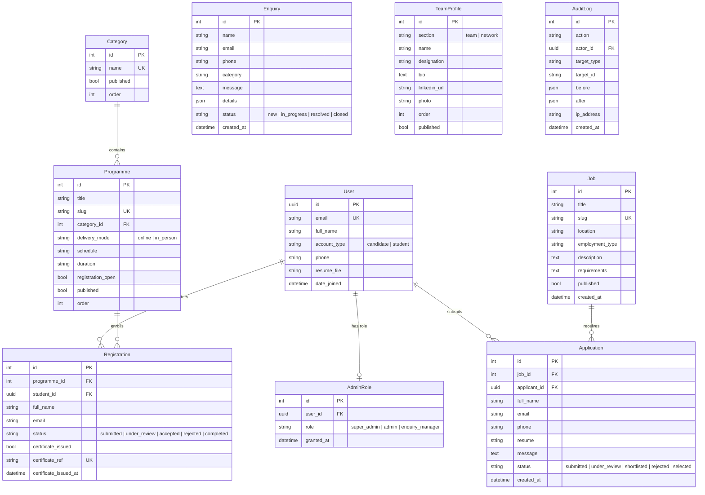

# GCTT Enterprise Platform: Single Unified Master Blueprint

> **Stack**: Django 5.2 LTS + HTMX 2.0 + Tailwind CSS 4 (Standalone) + PostgreSQL 16 (Neon) + WeasyPrint  
> **Target Directory**: `~/projects/gctt-django`  
> **Reference Codebase**: `/home/mohdfaizanali/Downloads/gctt` (visual styling & copy reference)  
> **Tooling**: Built with `uv` and designed for end-to-end execution with **OpenCode CLI**.

---

## 1. Executive Architecture & Decision Record

Following the architectural interview, every design branch is locked:

| Dimension | Decision | Rationale |
|:---|:---|:---|
| **Architecture** | Django Monolith + HTMX 2.0 | Zero Node.js/npm dependencies, unified Python codebase, built-in CSRF, sessions, and Django Admin. |
| **CMS Strategy** | Code-First Content (No CMS) | Marketing text lives directly in semantic Django templates. Django Admin manages business operations only. |
| **User Portals** | Candidate & Student Portals | Candidates track job applications with resume uploads; Students track course registrations and download certificates. |
| **Employer Strategy** | B2B Consultative Intake | Dedicated intake forms for staffing/talent requirements. No empty self-service employer job boards. |
| **Authentication** | Email/Password + Google OAuth | Email-based authentication (no usernames) via `django-allauth`. Google OAuth enabled once GCP client ID is provided. |
| **File Storage** | Local Disk (Dev) / Cloudflare R2 (Prod) | Ephemeral server storage bypassed using S3-compatible R2 (10 GB free, \$0 egress fees). |
| **Transactional Email** | Resend via `django-anymail` | 3,000 free emails/month. Console backend used during development. |
| **Hosting & Database** | Railway + Neon PostgreSQL | Zero-config Git push deployment to Railway paired with Neon's free-tier serverless PostgreSQL. |
| **Domain Strategy** | Staging Domain First | Verified on `*.up.railway.app` prior to pointing `gctekton.com` DNS records. |
| **Data Strategy** | Clean Slate Seed | Fresh production database. Super admin seeded via management command. |

---

## 2. Target File Tree

```
~/projects/gctt-django/
├── manage.py
├── pyproject.toml
├── uv.lock
├── Procfile                      # Railway deployment definition
├── runtime.txt                   # python-3.12.8
├── .env.example
├── .gitignore
│
├── config/                       # Project configuration
│   ├── __init__.py
│   ├── settings/
│   │   ├── __init__.py
│   │   ├── base.py               # Shared settings
│   │   ├── development.py        # Local dev (SQLite fallback, console email)
│   │   └── production.py         # Production (PostgreSQL, R2, Resend, HTTPS)
│   ├── urls.py                   # Master URL routing
│   ├── wsgi.py
│   └── asgi.py
│
├── apps/
│   ├── core/                     # Constants, context processors, middleware, audit
│   │   ├── constants.py          # COMPANY dictionary, SERVICES, NAV_ITEMS
│   │   ├── context_processors.py # Injects COMPANY & NAV into all templates
│   │   ├── middleware.py         # Security headers (CSP, HSTS, X-Frame)
│   │   ├── models.py             # AuditLog model
│   │   ├── admin.py              # AuditLogAdmin (read-only)
│   │   └── templatetags/
│   │       └── core_tags.py      # Schema.org JSON-LD tags, active nav helpers
│   │
│   ├── accounts/                 # User model, authentication, roles, dashboards
│   │   ├── models.py             # User (AbstractUser, email login), AdminRole
│   │   ├── forms.py              # Signup, profile edit forms
│   │   ├── views.py              # Candidate & Student dashboards, profile management
│   │   ├── urls.py
│   │   ├── admin.py              # UserAdmin with inline roles
│   │   ├── decorators.py         # @role_required, @login_required_with_type
│   │   └── adapters.py           # allauth custom adapters
│   │
│   ├── jobs/                     # Careers, job listings, candidate applications
│   │   ├── models.py             # Job, Application
│   │   ├── forms.py              # JobApplicationForm (with file upload)
│   │   ├── views.py              # Job list, job detail, HTMX apply, candidate applications
│   │   ├── urls.py
│   │   └── admin.py              # JobAdmin, ApplicationAdmin (bulk status actions)
│   │
│   ├── training/                 # Courses, categories, registrations, certificates
│   │   ├── models.py             # Category, Programme, Registration
│   │   ├── forms.py              # ProgrammeRegistrationForm
│   │   ├── views.py              # Programme list, detail, HTMX register, certificate verification
│   │   ├── certificates.py       # WeasyPrint PDF generator
│   │   ├── urls.py
│   │   └── admin.py              # ProgrammeAdmin, RegistrationAdmin (issue certificates)
│   │
│   ├── enquiries/                # Contact and B2B staffing intake
│   │   ├── models.py             # Enquiry (status, category, structured details)
│   │   ├── forms.py              # General EnquiryForm & EmployerIntakeForm
│   │   ├── views.py              # HTMX submission endpoints
│   │   ├── urls.py
│   │   └── admin.py              # EnquiryAdmin (triage workflow)
│   │
│   ├── profiles/                 # Team and network directory
│   │   ├── models.py             # TeamProfile (team vs network)
│   │   ├── urls.py
│   │   └── admin.py              # TeamProfileAdmin
│   │
│   └── pages/                    # Static marketing pages & SEO
│       ├── views.py              # Home, About, Services, Legal, etc.
│       ├── sitemaps.py           # Django sitemap framework
│       └── urls.py
│
├── templates/
│   ├── base.html                 # Master layout (Tailwind, HTMX, Meta)
│   ├── partials/
│   │   ├── _header.html          # Desktop & mobile navigation
│   │   ├── _footer.html          # Footer links and company facts
│   │   └── _messages.html        # Toast notification component
│   ├── pages/                    # All 16 public marketing pages
│   │   ├── home.html
│   │   ├── about.html
│   │   ├── services.html
│   │   ├── it_staffing.html
│   │   ├── recruitment.html
│   │   ├── talent_acquisition.html
│   │   ├── sap_scrum.html
│   │   ├── career_restart.html
│   │   ├── employers.html
│   │   ├── contact.html
│   │   ├── privacy.html
│   │   └── terms.html
│   ├── accounts/
│   │   ├── candidate_dashboard.html
│   │   ├── student_dashboard.html
│   │   └── profile_edit.html
│   ├── jobs/
│   │   ├── job_list.html
│   │   ├── job_detail.html
│   │   ├── _job_cards.html       # HTMX partial for search
│   │   └── _apply_form.html      # HTMX modal/partial
│   ├── training/
│   │   ├── programme_list.html
│   │   ├── programme_detail.html
│   │   ├── certificate.html      # WeasyPrint A4 landscape template
│   │   └── verify.html           # Public certificate verification
│   ├── enquiries/
│   │   ├── _form.html            # HTMX partial
│   │   └── _success.html         # HTMX swap target
│   └── emails/                   # Transactional email templates
│       ├── enquiry_received.txt
│       ├── enquiry_alert.txt
│       ├── application_received.txt
│       └── certificate_issued.txt
│
├── static/
│   ├── css/
│   │   ├── input.css             # Tailwind source
│   │   └── output.css            # Compiled CSS (committed to git)
│   ├── js/
│   │   └── htmx.min.js          # HTMX 2.0.4 standalone binary
│   └── images/
│       ├── favicon.ico
│       └── og-gctt-v2.jpg
│
└── tests/
    ├── conftest.py               # Fixtures
    ├── factories.py              # factory_boy models
    └── test_smoke.py             # All 16 routes return 200
```

---

## 3. Database Schema Specification



---

## 4. Phase-by-Phase Build Specification

### Phase 1: Environment & Project Bootstrap
- **Path**: `~/projects/gctt-django`
- **Commands**:
  ```bash
  mkdir -p ~/projects/gctt-django && cd ~/projects/gctt-django
  uv init --name gctt --python 3.12
  uv add django==5.2.* django-allauth[socialaccount]==65.* django-htmx==1.* \
         django-anymail[resend]==12.* django-ratelimit==4.* django-csp==4.* \
         django-cleanup==9.* django-storages[boto3]==1.* pillow==11.* \
         weasyprint==63.* whitenoise==6.* gunicorn==23.* psycopg[binary]==3.* \
         python-decouple==3.* dj-database-url==2.* qrcode[pil]==8.*
  uv add --dev pytest==8.* pytest-django==4.* pytest-cov==6.* factory-boy==3.* ruff==0.*
  uv run django-admin startproject config .
  mkdir -p apps
  for app in core accounts jobs training enquiries profiles pages; do
      uv run python manage.py startapp $app apps/$app
  done
  ```
- **Tailwind Standalone CLI**:
  ```bash
  curl -sLO https://github.com/tailwindlabs/tailwindcss/releases/latest/download/tailwindcss-linux-x64
  chmod +x tailwindcss-linux-x64 && mv tailwindcss-linux-x64 tailwindcss
  ./tailwindcss -i static/css/input.css -o static/css/output.css --minify
  ```
- **Vendored HTMX**:
  ```bash
  mkdir -p static/js
  curl -sL https://unpkg.com/htmx.org@2.0.4/dist/htmx.min.js -o static/js/htmx.min.js
  ```

---

### Phase 2: Core Settings, Constants & Security Middleware

#### `apps/core/constants.py`
Preserve all company facts from `src/lib/site.ts`:
```python
COMPANY = {
    "name": "GCTT",
    "legal_name": "Global Center for Technology & Training",
    "tagline": "Bridging Talent. Connecting Opportunities.",
    "tagline2": "Your Bridge Between Talent and Opportunity.",
    "email": "Accounts@gctekton.com",
    "jobs_email": "Jobs@gctekton.com",
    "address": "2612 Laramie St, Irving TX 75062",
    "domain": "gctekton.com",
    "url": "https://gctekton.com",
}

SERVICES = [
    {
        "url": "/it-staffing/",
        "title": "IT Staffing",
        "text": "Connecting companies with skilled IT professionals for their technology teams.",
    },
    {
        "url": "/recruitment/",
        "title": "Recruitment",
        "text": "Share your hiring requirements and we help you find the right people.",
    },
    {
        "url": "/talent-acquisition/",
        "title": "Talent Acquisition",
        "text": "Support for companies building their teams around the talent they need.",
    },
    {
        "url": "/training/",
        "title": "Training & Development",
        "text": "Online and in-person training, with certificates on successful completion.",
    },
]

NAV_ITEMS = [
    {"id": "about", "label": "About", "url": "/about/"},
    {"id": "services", "label": "Services", "url": "/services/"},
    {"id": "sapscrum", "label": "SAP & Scrum", "url": "/sap-scrum/"},
    {"id": "training", "label": "Training", "url": "/training/"},
    {"id": "careers", "label": "Careers", "url": "/careers/"},
    {"id": "restart", "label": "Career Restart", "url": "/career-restart/"},
    {"id": "employers", "label": "For Employers", "url": "/employers/"},
    {"id": "contact", "label": "Contact", "url": "/contact/"},
]
```

#### `apps/core/middleware.py`
```python
class SecurityHeadersMiddleware:
    def __init__(self, get_response):
        self.get_response = get_response

    def __call__(self, request):
        response = self.get_response(request)
        response["X-Frame-Options"] = "DENY"
        response["X-Content-Type-Options"] = "nosniff"
        response["Referrer-Policy"] = "strict-origin-when-cross-origin"
        response["Permissions-Policy"] = "camera=(), microphone=(), geolocation=()"
        response["Content-Security-Policy"] = (
            "default-src 'self'; "
            "script-src 'self' 'unsafe-inline' https://challenges.cloudflare.com; "
            "style-src 'self' 'unsafe-inline' https://fonts.googleapis.com; "
            "font-src 'self' https://fonts.gstatic.com; "
            "img-src 'self' data: https: blob:; "
            "frame-src https://challenges.cloudflare.com; "
            "frame-ancestors 'none';"
        )
        return response
```

---

### Phase 3: Models & Database Layer

#### `apps/accounts/models.py`
```python
import uuid
from django.contrib.auth.models import AbstractUser, BaseUserManager
from django.db import models
from django.utils.translation import gettext_lazy as _

class UserManager(BaseUserManager):
    def create_user(self, email, password=None, **extra_fields):
        if not email:
            raise ValueError(_("Email is required"))
        email = self.normalize_email(email)
        user = self.model(email=email, **extra_fields)
        user.set_password(password)
        user.save(using=self._db)
        return user

    def create_superuser(self, email, password=None, **extra_fields):
        extra_fields.setdefault("is_staff", True)
        extra_fields.setdefault("is_superuser", True)
        return self.create_user(email, password, **extra_fields)

class User(AbstractUser):
    class AccountType(models.TextChoices):
        CANDIDATE = "candidate", _("Candidate")
        STUDENT = "student", _("Training Student")

    id = models.UUIDField(primary_key=True, default=uuid.uuid4, editable=False)
    username = None
    email = models.EmailField(_("email address"), unique=True)
    full_name = models.CharField(max_length=120)
    account_type = models.CharField(
        max_length=20,
        choices=AccountType.choices,
        default=AccountType.CANDIDATE,
    )
    phone = models.CharField(max_length=40, blank=True)
    bio = models.TextField(max_length=2000, blank=True)
    resume = models.FileField(upload_to="resumes/", blank=True)

    USERNAME_FIELD = "email"
    REQUIRED_FIELDS = ["full_name"]
    objects = UserManager()

    @property
    def is_candidate(self):
        return self.account_type == self.AccountType.CANDIDATE

    @property
    def is_student(self):
        return self.account_type == self.AccountType.STUDENT

class AdminRole(models.Model):
    class Role(models.TextChoices):
        SUPER_ADMIN = "super_admin", _("Super Admin")
        ADMIN = "admin", _("Admin")
        ENQUIRY_MANAGER = "enquiry_manager", _("Enquiry Manager")

    user = models.OneToOneField(User, on_delete=models.CASCADE, related_name="admin_role")
    role = models.CharField(max_length=20, choices=Role.choices)
    granted_at = models.DateTimeField(auto_now_add=True)

    def __str__(self):
        return f"{self.user.email} ({self.get_role_display()})"
```

#### `apps/jobs/models.py`
```python
from django.conf import settings
from django.db import models
from django.utils.text import slugify

class Job(models.Model):
    class EmploymentType(models.TextChoices):
        FULL_TIME = "full_time", "Full-time"
        PART_TIME = "part_time", "Part-time"
        CONTRACT = "contract", "Contract"
        INTERNSHIP = "internship", "Internship"

    title = models.CharField(max_length=200)
    slug = models.SlugField(max_length=220, unique=True, blank=True)
    location = models.CharField(max_length=200)
    employment_type = models.CharField(
        max_length=20,
        choices=EmploymentType.choices,
        default=EmploymentType.FULL_TIME,
    )
    description = models.TextField()
    requirements = models.TextField(blank=True)
    published = models.BooleanField(default=False, db_index=True)
    created_at = models.DateTimeField(auto_now_add=True)
    updated_at = models.DateTimeField(auto_now=True)

    class Meta:
        ordering = ["-created_at"]

    def save(self, *args, **kwargs):
        if not self.slug:
            self.slug = slugify(self.title)[:200]
        super().save(*args, **kwargs)

    def __str__(self):
        return self.title

class Application(models.Model):
    class Status(models.TextChoices):
        SUBMITTED = "submitted", "Submitted"
        UNDER_REVIEW = "under_review", "Under Review"
        SHORTLISTED = "shortlisted", "Shortlisted"
        REJECTED = "rejected", "Rejected"
        SELECTED = "selected", "Selected"

    job = models.ForeignKey(Job, on_delete=models.CASCADE, related_name="applications")
    applicant = models.ForeignKey(settings.AUTH_USER_MODEL, on_delete=models.CASCADE, related_name="applications")
    full_name = models.CharField(max_length=120)
    email = models.EmailField(max_length=200)
    phone = models.CharField(max_length=40, blank=True)
    message = models.TextField(max_length=4000, blank=True)
    resume = models.FileField(upload_to="resumes/applications/")
    status = models.CharField(
        max_length=20,
        choices=Status.choices,
        default=Status.SUBMITTED,
        db_index=True,
    )
    created_at = models.DateTimeField(auto_now_add=True)

    class Meta:
        ordering = ["-created_at"]
        constraints = [
            models.UniqueConstraint(fields=["job", "applicant"], name="one_application_per_job_user")
        ]
```

#### `apps/training/models.py`
```python
import uuid
from django.conf import settings
from django.db import models
from django.utils.text import slugify

class Category(models.Model):
    name = models.CharField(max_length=80, unique=True)
    published = models.BooleanField(default=False, db_index=True)
    order = models.PositiveIntegerField(default=0)

    class Meta:
        ordering = ["order", "name"]
        verbose_name_plural = "categories"

    def __str__(self):
        return self.name

class Programme(models.Model):
    class DeliveryMode(models.TextChoices):
        ONLINE = "online", "Online"
        IN_PERSON = "in_person", "In-person"

    title = models.CharField(max_length=200)
    slug = models.SlugField(max_length=220, unique=True, blank=True)
    category = models.ForeignKey(Category, on_delete=models.SET_NULL, null=True, blank=True, related_name="programmes")
    delivery_mode = models.CharField(max_length=20, choices=DeliveryMode.choices, default=DeliveryMode.ONLINE)
    schedule = models.CharField(max_length=200, blank=True)
    duration = models.CharField(max_length=100, blank=True)
    description = models.TextField()
    registration_open = models.BooleanField(default=False)
    published = models.BooleanField(default=False, db_index=True)
    order = models.PositiveIntegerField(default=0)
    created_at = models.DateTimeField(auto_now_add=True)

    class Meta:
        ordering = ["order", "-created_at"]

    def save(self, *args, **kwargs):
        if not self.slug:
            self.slug = slugify(self.title)[:200]
        super().save(*args, **kwargs)

    def __str__(self):
        return self.title

class Registration(models.Model):
    class Status(models.TextChoices):
        SUBMITTED = "submitted", "Submitted"
        UNDER_REVIEW = "under_review", "Under Review"
        ACCEPTED = "accepted", "Accepted"
        REJECTED = "rejected", "Rejected"
        COMPLETED = "completed", "Completed"

    programme = models.ForeignKey(Programme, on_delete=models.CASCADE, related_name="registrations")
    student = models.ForeignKey(settings.AUTH_USER_MODEL, on_delete=models.CASCADE, related_name="registrations")
    full_name = models.CharField(max_length=120)
    email = models.EmailField(max_length=200)
    phone = models.CharField(max_length=40, blank=True)
    message = models.TextField(max_length=4000, blank=True)
    status = models.CharField(max_length=20, choices=Status.choices, default=Status.SUBMITTED, db_index=True)
    certificate_issued = models.BooleanField(default=False)
    certificate_ref = models.CharField(max_length=100, blank=True, null=True, unique=True)
    certificate_issued_at = models.DateTimeField(null=True, blank=True)
    created_at = models.DateTimeField(auto_now_add=True)

    class Meta:
        ordering = ["-created_at"]
        constraints = [
            models.UniqueConstraint(fields=["programme", "student"], name="one_registration_per_programme")
        ]

    def issue_certificate(self):
        self.certificate_issued = True
        self.certificate_ref = f"GCTT-{uuid.uuid4().hex[:8].upper()}"
        from django.utils import timezone
        self.certificate_issued_at = timezone.now()
        self.save()
```

#### `apps/enquiries/models.py`
```python
from django.db import models

class Enquiry(models.Model):
    class Status(models.TextChoices):
        NEW = "new", "New"
        IN_PROGRESS = "in_progress", "In Progress"
        RESOLVED = "resolved", "Resolved"
        CLOSED = "closed", "Closed"

    class Category(models.TextChoices):
        IT_STAFFING = "it_staffing", "IT Staffing"
        RECRUITMENT = "recruitment", "Recruitment"
        TALENT_ACQUISITION = "talent_acquisition", "Talent Acquisition"
        TRAINING = "training", "Training & Development"
        CAREER_RESTART = "career_restart", "Career Restart"
        EMPLOYER_INTAKE = "employer_intake", "Employer Talent Request"
        GENERAL = "general", "General Enquiry"

    name = models.CharField(max_length=120)
    email = models.EmailField(max_length=200)
    phone = models.CharField(max_length=40, blank=True)
    category = models.CharField(max_length=30, choices=Category.choices, default=Category.GENERAL)
    message = models.TextField(max_length=4000)
    details = models.JSONField(default=dict, blank=True)
    status = models.CharField(max_length=20, choices=Status.choices, default=Status.NEW, db_index=True)
    created_at = models.DateTimeField(auto_now_add=True)

    class Meta:
        ordering = ["-created_at"]
        verbose_name_plural = "enquiries"

    def __str__(self):
        return f"{self.name} ({self.get_category_display()})"
```

---

### Phase 4: HTMX Views & Interactivity

#### Public Careers & HTMX Search (`apps/jobs/views.py`)
```python
from django.contrib.auth.decorators import login_required
from django.core.paginator import Paginator
from django.http import HttpResponseForbidden
from django.shortcuts import get_object_or_404, render
from django.views.decorators.http import require_POST
from apps.accounts.decorators import login_required_with_type
from .forms import ApplicationForm
from .models import Application, Job

def job_list(request):
    jobs = Job.objects.filter(published=True)
    q = request.GET.get("q", "").strip()
    if q:
        jobs = jobs.filter(title__icontains=q) | jobs.filter(location__icontains=q)
    
    paginator = Paginator(jobs, 10)
    page_obj = paginator.get_page(request.GET.get("page", 1))

    if request.htmx:
        return render(request, "jobs/_job_cards.html", {"page_obj": page_obj})
    return render(request, "jobs/job_list.html", {"page_obj": page_obj, "q": q})

@require_POST
@login_required_with_type("candidate")
def job_apply(request, slug):
    job = get_object_or_404(Job, slug=slug, published=True)
    if Application.objects.filter(job=job, applicant=request.user).exists():
        return HttpResponseForbidden("Already applied.")

    form = ApplicationForm(request.POST, request.FILES)
    if form.is_valid():
        app = form.save(commit=False)
        app.job = job
        app.applicant = request.user
        app.save()
        return render(request, "jobs/_apply_success.html", {"job": job})
    return render(request, "jobs/_apply_form.html", {"form": form, "job": job})
```

#### HTMX Enquiry & Intake Submissions (`apps/enquiries/views.py`)
```python
from django.shortcuts import render
from django.views.decorators.http import require_POST
from django_ratelimit.decorators import ratelimit
from .forms import EnquiryForm
from .models import Enquiry

@require_POST
@ratelimit(key="ip", rate="5/h", method="POST", block=True)
def submit_enquiry(request):
    form = EnquiryForm(request.POST)
    if form.is_valid():
        enquiry = form.save()
        # Trigger email alerts asynchronously or via signals
        return render(request, "enquiries/_success.html", {"enquiry": enquiry})
    return render(request, "enquiries/_form.html", {"form": form})
```

---

### Phase 5: PDF Certificate Generation with WeasyPrint

#### `apps/training/certificates.py`
```python
import io
from django.template.loader import render_to_string
from weasyprint import HTML
from apps.core.constants import COMPANY

def generate_certificate_pdf(registration):
    html_content = render_to_string("training/certificate.html", {
        "reg": registration,
        "COMPANY": COMPANY,
    })
    pdf_buffer = io.BytesIO()
    HTML(string=html_content).write_pdf(pdf_buffer)
    pdf_buffer.seek(0)
    return pdf_buffer.getvalue()
```

#### `templates/training/certificate.html` (A4 Landscape)
```html
<!DOCTYPE html>
<html>
<head>
<style>
  @page { size: A4 landscape; margin: 0; }
  body {
    font-family: 'Inter', system-ui, sans-serif;
    margin: 0; padding: 48px;
    background: #ffffff;
    box-sizing: border-box;
    display: flex; flex-direction: column;
    justify-content: center; align-items: center;
    border: 12px solid #1e3a8a;
  }
  .header { font-size: 32px; font-weight: 800; color: #1e3a8a; margin-bottom: 8px; }
  .subtitle { font-size: 16px; color: #4b5563; text-transform: uppercase; letter-spacing: 2px; }
  .cert-title { font-size: 26px; font-weight: 600; color: #111827; margin: 24px 0 12px; }
  .name { font-size: 38px; font-weight: 700; color: #1e40af; border-bottom: 2px solid #e5e7eb; padding-bottom: 8px; width: 80%; }
  .programme { font-size: 22px; font-weight: 600; color: #374151; margin-top: 16px; }
  .footer { margin-top: 40px; font-size: 12px; color: #9ca3af; text-align: center; }
  .ref { font-weight: 700; color: #4b5563; }
</style>
</head>
<body>
  <div class="header">{{ COMPANY.name }}</div>
  <div class="subtitle">Global Center for Technology & Training</div>
  <div class="cert-title">Certificate of Completion</div>
  <p style="color: #6b7280; margin: 0;">This is proudly presented to</p>
  <div class="name">{{ reg.full_name }}</div>
  <p style="color: #6b7280; margin-top: 16px;">for successfully completing the prescribed program</p>
  <div class="programme">{{ reg.programme.title }}</div>
  <div class="footer">
    <div>Issued: {{ reg.certificate_issued_at|date:"F j, Y" }}</div>
    <div class="ref">Certificate ID: {{ reg.certificate_ref }}</div>
    <div>Verification: {{ COMPANY.url }}/training/verify/{{ reg.certificate_ref }}/</div>
  </div>
</body>
</html>
```

---

### Phase 6: Django Admin Configuration

Replacing the old 800-line React Super Admin Dashboard:

```python
# apps/jobs/admin.py
from django.contrib import admin
from .models import Application, Job

class ApplicationInline(admin.TabularInline):
    model = Application
    extra = 0
    readonly_fields = ("applicant", "full_name", "email", "phone", "resume", "created_at")
    fields = ("full_name", "email", "status", "resume", "created_at")

@admin.register(Job)
class JobAdmin(admin.ModelAdmin):
    list_display = ("title", "location", "employment_type", "published", "created_at")
    list_filter = ("published", "employment_type")
    search_fields = ("title", "description", "location")
    list_editable = ("published",)
    prepopulated_fields = {"slug": ("title",)}
    inlines = [ApplicationInline]

@admin.register(Application)
class ApplicationAdmin(admin.ModelAdmin):
    list_display = ("full_name", "job", "email", "status", "created_at")
    list_filter = ("status", "job")
    search_fields = ("full_name", "email", "job__title")
    list_editable = ("status",)
    actions = ["mark_shortlisted", "mark_rejected"]

    @admin.action(description="Mark selected applications as Shortlisted")
    def mark_shortlisted(self, request, queryset):
        queryset.update(status="shortlisted")

    @admin.action(description="Mark selected applications as Rejected")
    def mark_rejected(self, request, queryset):
        queryset.update(status="rejected")
```

---

### Phase 7: Production Deployment & CI/CD

#### `Procfile` (Railway)
```
web: gunicorn config.wsgi:application --bind 0.0.0.0:$PORT --workers 2 --timeout 120
release: python manage.py migrate --noinput && python manage.py collectstatic --noinput
```

#### `.github/workflows/ci.yml`
```yaml
name: CI Quality Gate
on: [push, pull_request]

jobs:
  test:
    runs-on: ubuntu-latest
    steps:
      - uses: actions/checkout@v4
      - uses: astral-sh/setup-uv@v5
      - run: uv sync
      - run: uv run ruff check .
      - run: uv run python manage.py check
      - run: uv run pytest --cov=apps --cov-report=xml
      - run: uv run coverage report --fail-under=80
```

---

## 5. Seed Command for Super Admin

#### `apps/core/management/commands/seed_superadmin.py`
```python
from django.core.management.base import BaseCommand
from apps.accounts.models import AdminRole, User

class Command(BaseCommand):
    help = "Seed initial Super Admin account"

    def handle(self, *args, **options):
        email = "admingcctt@gmail.com"
        user, created = User.objects.get_or_create(
            email=email,
            defaults={
                "full_name": "GCTT Super Admin",
                "is_staff": True,
                "is_superuser": True,
            },
        )
        if created:
            user.set_password(os.environ["DJANGO_SUPER_ADMIN_PASSWORD"])
            user.save()
            AdminRole.objects.create(user=user, role="super_admin")
            self.stdout.write(self.style.SUCCESS(f"Created Super Admin: {email}"))
        else:
            self.stdout.write("Super Admin already exists.")
```

---

## 6. Verification Checklist Before Launch

1. **Smoke Test**: Run `pytest tests/test_smoke.py` to ensure all 16 public URLs return HTTP 200.
2. **Form Rate Limiting**: Attempt 6 submissions in 5 minutes; confirm the 6th returns HTTP 429.
3. **Application Duplicate Block**: Apply twice to the same job as a candidate; confirm unique constraint handles it gracefully.
4. **Certificate Verification**: Complete a registration in Admin, generate certificate, verify QR/URL at `/training/verify/<ref>/`.
5. **CSRF & Security Audit**: Run `python manage.py check --deploy`; ensure zero critical warnings.
6. **DNS Repointing**: Point `gctekton.com` CNAME record to the Railway live deployment endpoint.
